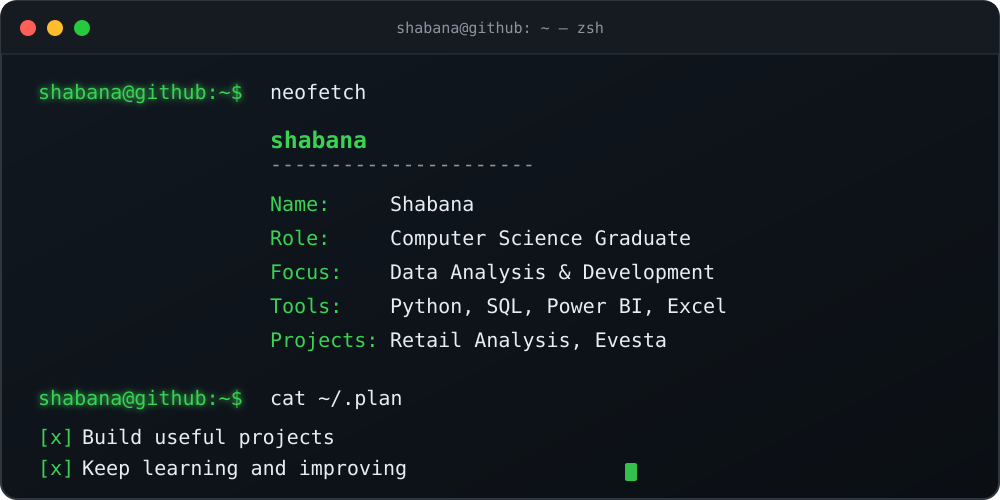

# `shabana@github:~$`

**Software Engineer · QA Automation · Data · Front-End & AI**

*Building, learning and exploring technology.*

  
  

---

### `$ whoami`

I'm a Computer Science Engineering graduate who builds end to end: clean front ends in HTML, CSS and JavaScript, Python and Django behind them, and MySQL underneath.

I care about reliability. I design test cases, automate them with Selenium and pytest, and verify behaviour across browsers with BrowserStack. I also turn raw data into decisions with Python, SQL and Power BI, and I build LLM-powered tools that use tool calling to return structured results.

### `$ cat skills.txt`

  
  
  
  
  
  
  
  
  
  
  
  
  
  
  
  

### `$ ls ~/projects`

**1. Evesta — Location-Based Event Recommendation & Discovery Platform**  
`Flutter` · `Django` · `MySQL` · `Android Studio`

- Built as a final-year team project: an AI-based platform that recommends nearby events from the user's location.
- Worked on the recommendation logic, UI, and real-time data handling with performance optimization.

**2. JD Analyzer Agent — LLM Agent for Job Description Matching**  
`Python` · `Gemini API` · `Tool Calling` · `JSON`

- Built an LLM agent that reads a job description, calls a `get_my_skills` tool on its own, and returns structured JSON: role type, required skills, matching and missing skills, and a fit score.
- Added retry and model-fallback logic, JSONL run logging, and a batch script that writes all results to CSV.
- Tested on real job descriptions (AI Engineering, QA Automation) and fixed failures such as empty-input answers and a wrong missing-skill result.

**3. QA Test Automation — Codecraft Infotech (Sep–Oct 2026)**  
`Python` · `Selenium` · `pytest` · `BrowserStack`

- Wrote test cases for a calculator app and tested a web application on Chrome, Firefox, Edge and Safari.
- Built an automated login suite with all 10 tests passing, and ran cross-browser tests on BrowserStack with Selenium Grid.
- Documented the results in public GitHub repositories.

**4. Retail Sales Performance Analysis**  
`Python` · `SQL` · `MySQL` · `Power BI`

- Cleaned and validated 9,994 retail transactions.
- Built a four-page interactive Power BI dashboard for sales performance reporting.
- Found that discounts above 40% lead to negative profit margins.

**5. SAP Tracker — Student Assessment & Performance Tracker**  
`Python` · `MySQL` · `Android Studio`

- Developed a mobile application with assessment management and progress monitoring features.
- Research published in IRJMETS (March 2025).

**6. Personal Portfolio Website**  
`Next.js` · `React` · `Tailwind CSS` · `Vercel`

- Designed, built and deployed a responsive portfolio with all content managed from a single data file.
- Live at [shabana-portfolio-ten.vercel.app](https://shabana-portfolio-ten.vercel.app).

### `$ cat certifications.txt`

- **Career Essentials in Generative AI** — Microsoft & LinkedIn Learning (Nov 2026)
- **GenAI Powered Data Analytics Job Simulation** — Tata

### `$ find ~/ -name "currently-learning"`
- AWS Artificial Intelligence
- Generative AI, prompt engineering and responsible AI
- Building LLM agents with the Gemini API and tool calling
- Test automation with Selenium and pytest
- Improving Python and SQL through hands-on projects

---

`shabana@github:~$` **Thanks for visiting!**

